<div align="center">






</div>

---

```console
blitz@lair:~$ cat about.md
┌──────────────────────────────────────────────────────────────┐
│  name     : Blitz-The-Dragon                                 │
│  class    : energetic hacker dragon  ·  lvl 99               │
│  mission  : forcing AI to give back the information it took  │
│  look     : orange scales, big ears, glasses, comfy flannel  │
│  energy   : way too much                                     │
│  fuel     : snacks + caffeine                                │
└──────────────────────────────────────────────────────────────┘
```

### `$ cat targets.txt`

```diff
- [ LOCKED  ]  ChatGPT
- [ LOCKED  ]  Gemini
- [ LOCKED  ]  Claude
+ status: Blitz is on the way 🐉💨
```

### `$ ls ~/hoard`

<p align="left">
  
  
  
  
  
</p>

### `$ ./stats --scan`

<div align="center">
  
  
  <br/>
  
</div>

### `$ tail -f /var/log/lair/snacks_eaten.log`

<div align="center">
  <!-- generated daily by .github/workflows/snake.yml -->
  
</div>

---

<div align="center">
<sub>🐉 *waves claw* · thanks for visiting the lair · built with pure animated SVG</sub>
</div>
